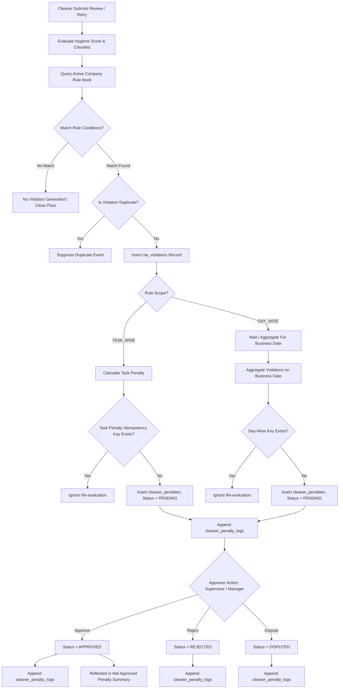
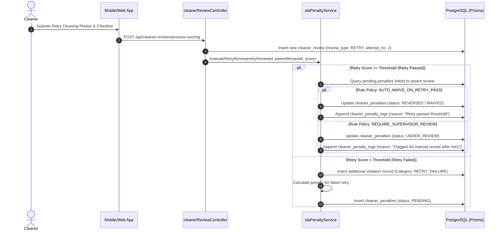
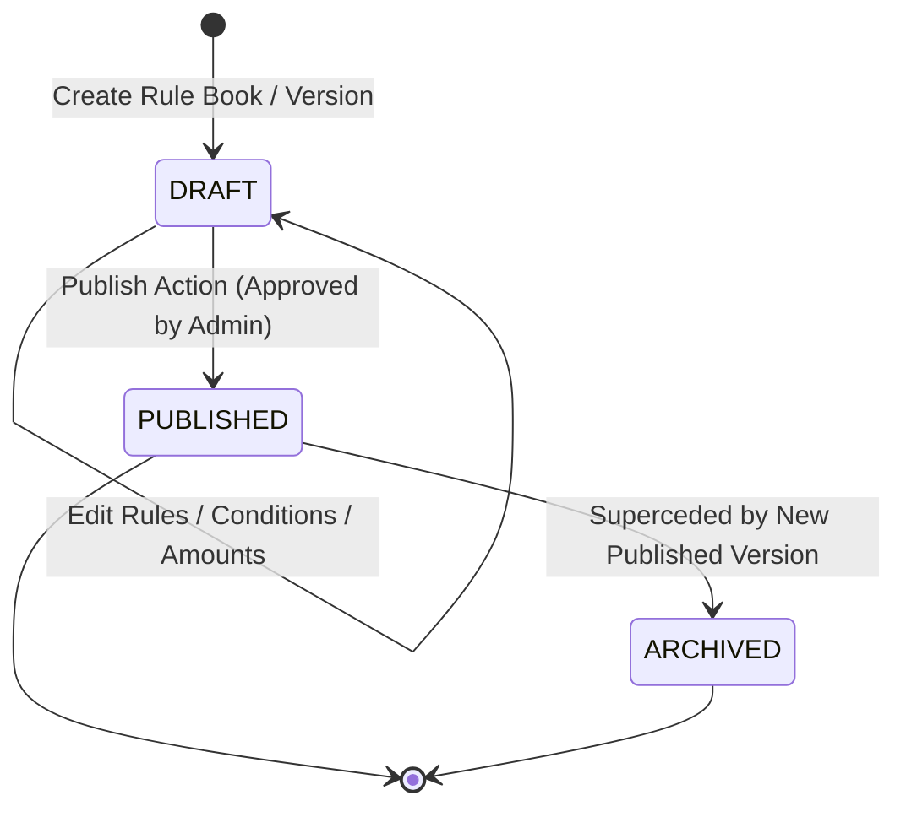
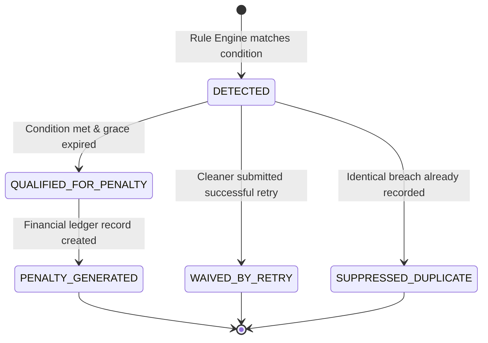
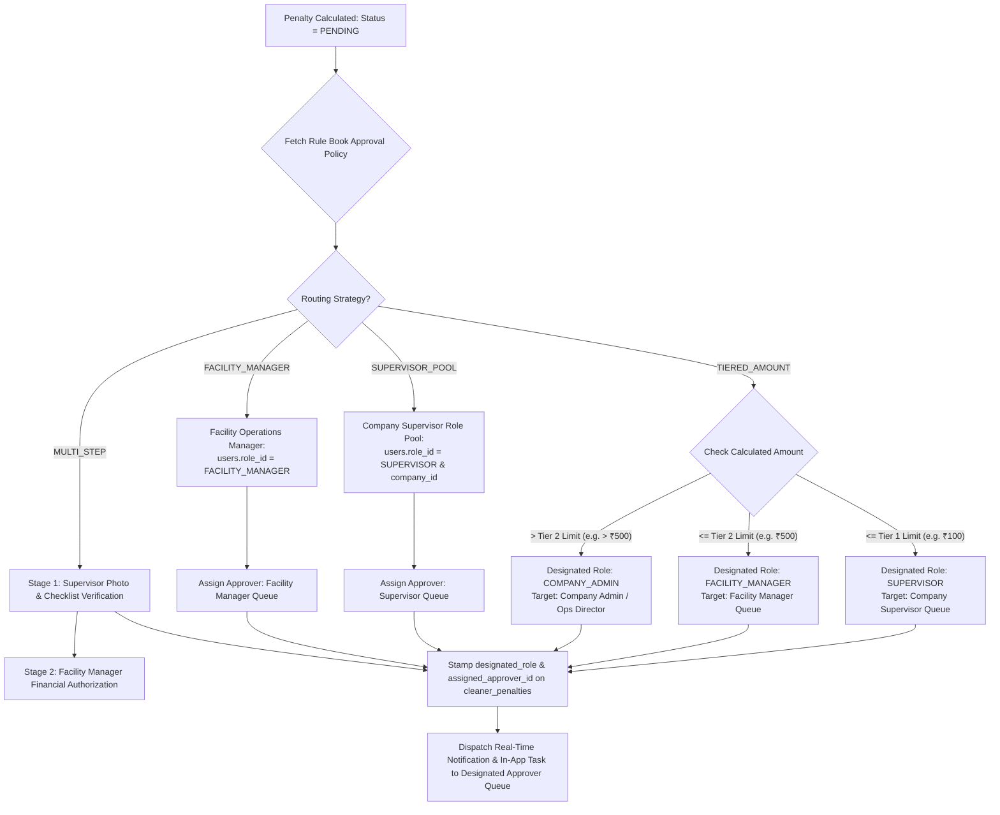
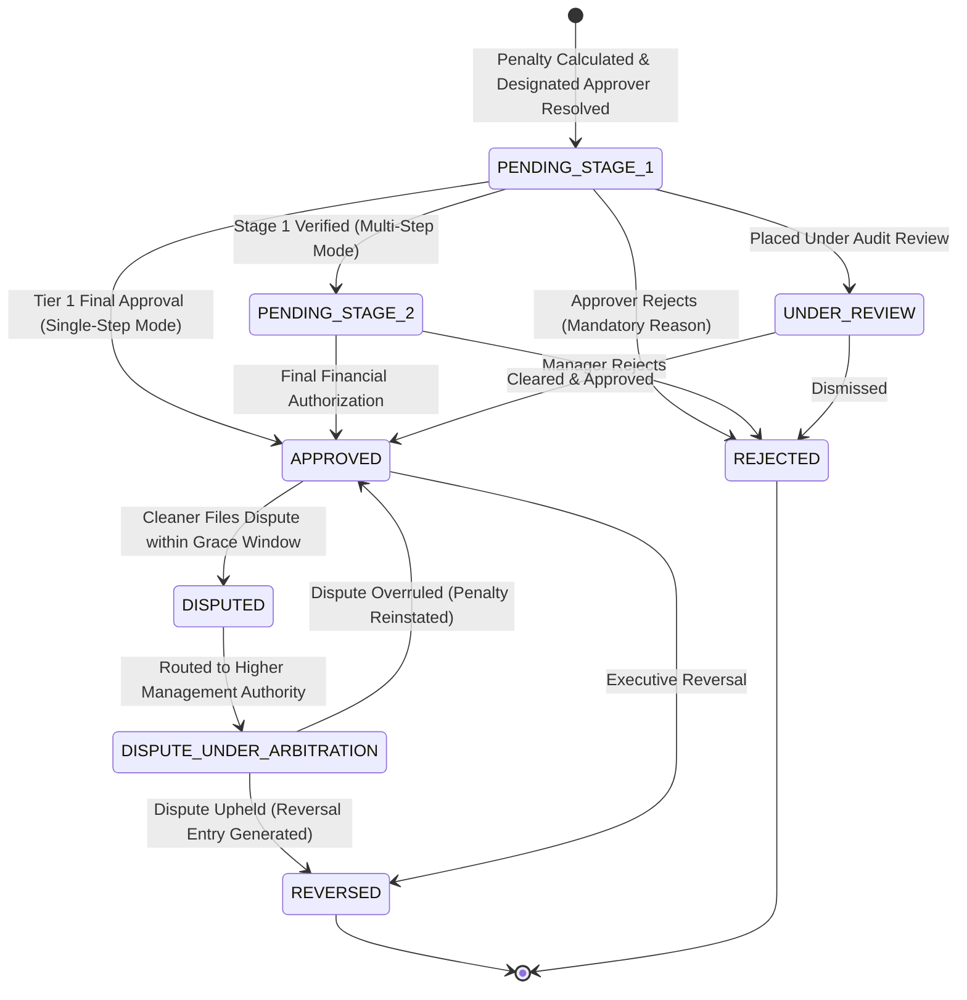
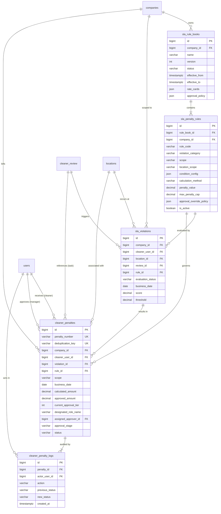

# Daily Dash — Dynamic SLA Penalty Management System
## Architecture Design Document (ADD)

**Document Version:** 1.0.0  
**Target System:** Daily Dash / SaafAI Backend  
**Document Status:** Architecture Design & Planning (Pre-Implementation Reference)  
**Authors:** Senior Backend & Distributed Systems Architecture Team  
**Date:** November 2026  

---

## Executive Summary

Daily Dash (SaafAI) provides facility hygiene monitoring, computer-vision/manual scoring, location management, and cleaner task assignment. The **Dynamic SLA Penalty Management System** introduces a multi-tenant, rule-driven evaluation and ledger engine that calculates financial penalties directly against cleaner activity violations based on company-configured rule books. 

### Critical Architecture Boundaries
* **Strict Non-HRMS Scope:** This system is **not** an HRMS, payroll system, attendance tracker, or salary component manager. It calculates and tracks cleaner-wise financial penalties, their rule justifications, approval states, and net balances.
* **Direct Review-Driven Evaluation (No Escalation Dependencies):** The penalty system evaluates directly against cleaning activities, inspection reviews (`cleaner_review`), hygiene scores (`hygiene_scores`), and task schedules. It has zero coupling with operational alert timers or notification escalations.
* **Zero Disruption to Existing Review Pipeline:** The existing `cleaner_review` and `hygiene_scores` tables remain completely intact. No review data, images, or scoring histories will be overwritten.

---

## Table of Contents

1. [Project Context & Boundaries](#1-project-context--boundaries)
2. [Existing Backend Inspection & Reality Check](#2-existing-backend-inspection--reality-check)
3. [Existing Models to Reuse vs. Proposed Architecture](#3-existing-models-to-reuse-vs-proposed-architecture)
4. [End-to-End System Architecture](#4-end-to-end-system-architecture)
5. [Mermaid Architecture & Flow Diagrams](#5-mermaid-architecture--flow-diagrams)
6. [Dynamic Company Rule Book](#6-dynamic-company-rule-book)
7. [Violation Categories & Extensibility](#7-violation-categories--extensibility)
8. [Structured Rule Conditions Engine](#8-structured-rule-conditions-engine)
9. [Penalty Scope Architecture (Task-Wise vs. Day-Wise)](#9-penalty-scope-architecture-task-wise-vs-day-wise)
10. [Penalty Calculation Engine & Financial Arithmetic](#10-penalty-calculation-engine--financial-arithmetic)
11. [Rule Book Versioning & Immutability](#11-rule-book-versioning--immutability)
12. [SLA Violation Records Lifecycle](#12-sla-violation-records-lifecycle)
13. [Existing Cleaner Review Integration & Retry Preservation](#13-existing-cleaner-review-integration--retry-preservation)
14. [Dynamic Approval Hierarchy & Role-Based Routing](#14-dynamic-approval-hierarchy--role-based-routing)
15. [Cleaner Penalty Ledger](#15-cleaner-penalty-ledger)
16. [Cleaner Penalty Summary Formulas](#16-cleaner-penalty-summary-formulas)
17. [Database Architecture & Schema Design](#17-database-architecture--schema-design)
18. [Entity Relationship Diagram (ERD)](#18-entity-relationship-diagram-erd)
19. [API Specification](#19-api-specification)
20. [Penalty Management Dashboard Design](#20-penalty-management-dashboard-design)
21. [Duplicate Prevention & Idempotency Guarantees](#21-duplicate-prevention--idempotency-guarantees)
22. [Security, Tenancy Isolation & Legal Considerations](#22-security-tenancy-isolation--legal-considerations)
23. [Implementation Milestones & Execution Plan](#23-implementation-milestones--execution-plan)

---

## 1. Project Context & Boundaries

### 1.1 Business Goals
1. Provide facility management companies the ability to formulate and enforce contractual SLA penalties tailored to their client agreements.
2. Provide transparent, audit-proof traceability:
   - *When* a cleaner received a penalty.
   - *Which specific rule* and *which rule version* caused the penalty.
   - *What score, threshold, or deadline* was breached (with photo/inspection evidence).
   - *How* the penalty was mathematically derived.
   - *Current approval status* (Pending, Approved, Rejected, Disputed, Reversed).
3. Distinguish between task-level execution failures and day-level aggregate non-compliance.

### 1.2 Explicit Non-Goals (Out of Scope)
* **No HRMS / Payroll Processing:** No tax withholding, provident fund, insurance deductions, base wage management, or bank disbursement integration.
* **No Salary Slip Generation:** The module generates an exportable cleaner penalty summary ledger that an external payroll or accounts department can ingest as a deduction reference.
* **No Attendance / Shift Rate Accounting:** Does not manage hourly wages, overtime multipliers, or punch-in/punch-out pay rates.

---

## 2. Existing Backend Inspection & Reality Check

A deep inspection of the `Daily-Dash-Backend-Development` codebase reveals the following concrete architecture:

### 2.1 Key Discoveries & Model Audit

| Entity | Actual Existing Database Model | Realities & Field Specifics |
| :--- | :--- | :--- |
| **Company** | `companies` | Primary key `id` (`BigInt`). Contains `name`, `status`, `onboarding_metadata`. Multi-tenancy anchor across the platform. |
| **User / Cleaner** | `users` | Primary key `id` (`BigInt`). Cleaners are identified by `role_id` referencing `Role` (where role is cleaner) and `company_id`. |
| **Cleaner Assignment** | `cleaner_assignments` | Maps `cleaner_user_id` to `location_id` and `company_id`. Includes `assigned_sections: Int[]`. *(Note: `supervisor_id` is removed; supervisor assignment is role-based via `users.role_id` and `company_id`).* |
| **Location** | `locations` | Washrooms and inspection sites. Linked to `company_id`, `facility_company_id`, and `type_id` (`location_types`). Has `sla_config: Json`. *(Note: `parent_id` is removed; type/category hierarchy is maintained in `location_types.parent_id`).* |
| **Cleaning Activity / Task** | **`cleaner_review`** | **Critical Discovery:** There is **NO** standalone `tasks` model in the database. Cleaning activities are tracked per inspection submission in `cleaner_review`. The checklist tasks executed during a review are stored as `tasks: String[]`. |
| **Task / Activity Value** | **DOES NOT EXIST** | Neither `cleaner_review`, `locations`, nor `configurations` store a monetary task rate, cleaning fee, or contractual activity value. |
| **Review & Retry** | `cleaner_review` | Original reviews have `attempt_no = 1`, `review_type = "ORIGINAL"`, and `parent_review_id = NULL`. Retries have `attempt_no > 1`, `review_type = "RETRY"`, `parent_review_id = <original_id>`, and `is_latest: Boolean`. Scores and photos are never overwritten. |
| **Hygiene Scores** | `hygiene_scores` | Linked to `cleaner_review` via `hygiene_score_id`. Stores AI/manual Decimal score, image URLs, and inspection breakdown JSON. |
| **Company Config** | `configurations` | Key-value/JSON config table with unique `[name, company_id]`. Holds master configuration and threshold rules. |
| **Operational Escalation** | `sla_escalations` *(Existing)* | Exists in DB for alert timers, but is **explicitly excluded** from the Penalty Management System. Penalties evaluate directly on cleaning reviews. |

### 2.2 Identification Mechanics in the Existing System
1. **Cleaner Identification:** `cleaner_review.cleaner_user_id` is the primary foreign key. The system enforces `if (!review.cleaner_user_id) skip;` because anonymous reviews cannot be penalized.
2. **Company Identification:** Available directly on `cleaner_review.company_id` and cascaded from `locations.company_id`.
3. **Location Identification:** `cleaner_review.location_id` pointing to `locations.id`.
4. **Activity Identification:** Each inspection run is identified by `cleaner_review.id`.
5. **Business Date Determination:** Computed in Indian Standard Time (IST, UTC+5:30) as:
   ```javascript
   const istDate = new Date(reviewCreatedAt.getTime() + (5.5 * 60 * 60 * 1000));
   const businessDate = new Date(Date.UTC(istDate.getUTCFullYear(), istDate.getUTCMonth(), istDate.getUTCDate()));
   ```

### 2.3 Task Value Gap Analysis & Minimal Required Addition
Because no task or activity value exists in the database today, any rule relying on `TASK_VALUE_PERCENTAGE` or `TASK_VALUE_FIXED_DEDUCTION` requires a reference baseline.
* **Architectural Decision:** We will introduce an optional `task_value_reference` inside the company's rule configuration (e.g. ₹100 standard washroom cleaning rate) and an optional `rate_cards` mapping in `sla_rule_books` (e.g., mapping location type or task name to a base value).
* **Guiding Principle:** If no task value is defined or applicable, the rule engine falls back to `FIXED_AMOUNT` or rejects rules requiring a missing baseline, preventing runtime crashes.

---

## 3. Existing Models to Reuse vs. Proposed Architecture

```
+----------------------------------------------------------------------------------------------------+
|                                    EXISTING MODELS (REUSED AS-IS)                                  |
+--------------------------+----------------------------+-----------------------+--------------------+
|       companies          |          users             |       locations       |   cleaner_review   |
|  (Multi-tenant root)     |   (Cleaners, Supervisors)  |  (Washroom entities)  | (Task submissions) |
+--------------------------+----------------------------+-----------------------+--------------------+
|     hygiene_scores       |      configurations        |                                            |
| (AI inspection scoring)  |     (Master config)        |                                            |
+--------------------------+----------------------------+--------------------------------------------+
                                           |
                                  Review & Task Events
                                           v
+----------------------------------------------------------------------------------------------------+
|                                      PROPOSED NEW MODELS                                           |
+--------------------------+----------------------------+--------------------------------------------+
|      sla_rule_books      |      sla_penalty_rules     |               sla_violations               |
| (Versioned company book) | (Configurable rule items)  |         (Rule infraction evidence)         |
+--------------------------+----------------------------+--------------------------------------------+
|    cleaner_penalties     |    cleaner_penalty_logs    |                                            |
| (Financial ledger items) | (Financial audit history)  |                                            |
+--------------------------+----------------------------+--------------------------------------------+
```

---

## 4. End-to-End System Architecture

The Dynamic SLA Penalty Management System operates as an asynchronous, event-driven module embedded within the existing Express.js backend.

### Modular Components & Responsibilities

```
                                  [ Cleaning Activity / Submission / Retry ]
                                                       │
                                                       ▼
                                           ┌───────────────────────┐
                                           │ cleanerReviewController│
                                           │  (or Review Evaluator) │
                                           └───────────┬───────────┘
                                                       │
                                                       │ (Review Completed / Scored)
                                                       ▼
                                           ┌─────────────────────────┐
                                           │  slaPenaltyEvaluation   │
                                           │         Service         │
                                           └───────────┬─────────────┘
                                                       │
                                                       ▼
                                           ┌─────────────────────────┐
                                           │  Dynamic SLA Rule Book  │
                                           │ (Active Company Version)│
                                           └───────────┬─────────────┘
                                                       │
                                                       ▼
                                           ┌─────────────────────────┐
                                           │  Condition Validator &  │
                                           │    Evaluation Engine    │
                                           └───────────┬─────────────┘
                                                       │
                                                       ▼
                                           ┌─────────────────────────┐
                                           │      sla_violations     │
                                           │   (Deduplicated Record) │
                                           └───────────┬─────────────┘
                                                       │
                                                       ▼
                                           ┌─────────────────────────┐
                                           │ Penalty Calculation     │
                                           │ Engine (Decimal Math)   │
                                           └───────────┬─────────────┘
                                                       │
                                                       ▼
                                           ┌─────────────────────────┐
                                           │   cleaner_penalties     │
                                           │   (Ledger / Pending)    │
                                           └───────────┬─────────────┘
                                                       │
                                ┌──────────────────────┴──────────────────────┐
                                ▼                                             ▼
                   ┌─────────────────────────┐                   ┌─────────────────────────┐
                   │  Approver Queue Review  │                   │ Cleaner Penalty Summary │
                   │ (Approve/Reject/Dispute)│                   │ (Aggregated Net Ledger) │
                   └────────────┬────────────┘                   └─────────────────────────┘
                                │
                                ▼
                   ┌─────────────────────────┐
                   │  cleaner_penalty_logs   │
                   │  (Immutable Audit Log)  │
                   └─────────────────────────┘
```

1. **Company Rule Book Manager:** Administers company-specific rule books and publishes immutable rule versions.
2. **SLA Penalty Evaluation Service:** Triggered by review submissions or the cron worker. Evaluates context against active rule conditions.
3. **Condition Evaluator:** A deterministic AST/JSON condition interpreter (safe, no `eval()`).
4. **Violation Recorder (`sla_violations`):** Persists evidence-linked violation facts.
5. **Penalty Calculation Engine:** Executes financial formulas with `Decimal.js` precision, minimum/maximum clamping, and caps.
6. **Penalty Ledger (`cleaner_penalties`):** Records financial transactions, tracking approval states (`PENDING`, `APPROVED`, `REJECTED`, `DISPUTED`, `REVERSED`).
7. **Audit Logger (`cleaner_penalty_logs`):** Append-only log recording actor, timestamp, status transition, and financial variance.
8. **Summary & Reporting API:** Computes aggregated net balances on-demand from ledger records without maintaining fragile counter caches.

---

## 5. Mermaid Architecture & Flow Diagrams

### 5.1 End-to-End Processing Flow



### 5.2 Retry Review & Waive/Review Decision Flow



---

## 6. Dynamic Company Rule Book

### 6.1 SLA Rule Book vs. SLA Penalty Rules: Core Conceptual Distinction

A frequent architectural question in rule-based systems is: *Why separate `sla_rule_books` and `sla_penalty_rules` instead of storing rules in a single flat table?*

The system employs a strict **Two-Tier Contract Hierarchy** (Book Container $\rightarrow$ Rule Clauses):

```
┌─────────────────────────────────────────────────────────────────────────────────────────┐
│                      SLA RULE BOOK (Container / Contract Header)                         │
│  Entity: sla_rule_books                                                                 │
│  • Represents: Contract Agreement, Site Policy, Policy Version (e.g., "Metro FY27 v2")  │
│  • Scope: Company-wide or Site-wide metadata, Currency, Rate Cards, Approval Policies    │
│  • Lifecycle: DRAFT ──(Publish)──> PUBLISHED ──(Superceded)──> ARCHIVED                 │
└───────────────────────────────────────────┬─────────────────────────────────────────────┘
                                            │ 1 : N (Contains multiple clauses)
                                            ▼
┌─────────────────────────────────────────────────────────────────────────────────────────┐
│                     SLA PENALTY RULES (Individual Infraction Clauses)                    │
│  Entity: sla_penalty_rules                                                              │
│  • Represents: Single enforceable rule (e.g., "Score < 5.0", "Missed Dustbin Cleaning")  │
│  • Scope: Condition AST, Trigger Category, Penalty Formula, Floor/Cap, Retry Resolution │
│  • Lifecycle: Active / Inactive within its parent Rule Book                             │
└─────────────────────────────────────────────────────────────────────────────────────────┘
```

#### Detailed Comparison Matrix

| Architectural Dimension | SLA Rule Book (`sla_rule_books`) | SLA Penalty Rules (`sla_penalty_rules`) |
| :--- | :--- | :--- |
| **Real-World Analogy** | The **Master Service Agreement (MSA)** or Service Contract binder. | An **Individual Contract Clause or Penalty Schedule**. |
| **Cardinality** | 1 per Company / Contract version. | Many ($N$) rules per Rule Book. |
| **Primary Responsibility** | Manages contract lifecycle, atomic publishing, contract rate cards, business hours, and default approval policies. | Manages specific infraction detection, condition evaluation, and financial formula calculation. |
| **Key Attributes** | `company_id`, `version`, `status` (`DRAFT`/`PUBLISHED`), `effective_from`, `rate_cards`, `business_day_start_hour`. | `rule_code`, `violation_category`, `scope`, `condition_config`, `calculation_method`, `penalty_value`, `max_penalty_cap`. |
| **Immutability Trigger** | Publishing a new version locks the entire rule set atomically. | Inherits immutability from parent book once published. Cannot be mutated post-publish. |

#### Why This Separation Is Crucial
1. **Atomic Versioning Without Data Corruption:** An SLA contract typically defines 15–30 rules. If a company negotiates a change to 3 rules starting next month, editing existing rows directly would corrupt historical penalty audit trails. Under this architecture, the company drafts Version 2 of the Rule Book, adjusts the rules, and publishes it. Past penalties remain linked to Version 1; new cleaning submissions evaluate against Version 2.
2. **Contract & Site Segmentation:** A single facility management company often manages multiple client sites with distinct contract terms (e.g., Airport Terminal contract vs. Corporate Office contract). Rule Books allow site-level or contract-level rule segregation under the same tenant.
3. **Inheritance of Common Parameters:** Global definitions—such as rate cards (base cleaning task rates), business day boundaries (for night shifts), and approval routing policies—are defined once at the Rule Book level rather than copied across 30 rules.
4. **Draft Safety & Staging:** Operations managers can safely stage, test, and preview new rule combinations in a `DRAFT` Rule Book without prematurely affecting live cleaning submissions.

---

### 6.2 Company Rule Book Schema & Isolation
Each company maintains its own independent Rule Book. Under no circumstances are company rules shared, cross-polled, or hardcoded in JavaScript switch statements.

```
┌────────────────────────────────────────────────────────┐
│                   sla_rule_books                       │
├────────────────────────────────────────────────────────┤
│ id: BigInt (PK)                                        │
│ company_id: BigInt (FK -> companies.id)                │
│ name: "Standard Facility Cleaning SLA Rulebook"        │
│ version: 2                                             │
│ status: "PUBLISHED" ("DRAFT" | "PUBLISHED" | "ARCHIVED")│
│ effective_from: 2026-11-01 00:00:00+05:30              │
│ effective_to: NULL                                     │
│ base_currency: "INR"                                   │
│ rate_cards: { "washroom": 100, "urinal": 50 }          │
│ approval_policy: { ... } (Dynamic Routing Config)      │
└───────────────────────────┬────────────────────────────┘
                            │ 1 : N
                            ▼
┌────────────────────────────────────────────────────────┐
│                  sla_penalty_rules                     │
├────────────────────────────────────────────────────────┤
│ id: BigInt (PK)                                        │
│ rule_book_id: BigInt (FK -> sla_rule_books.id)         │
│ company_id: BigInt (FK -> companies.id)                │
│ rule_code: "R-HYG-FAIL-01"                             │
│ name: "Severe Hygiene Failure (< 5.0)"                 │
│ violation_category: "HYGIENE_SCORE_BREACH"             │
│ violation_type: "SCORE_BELOW_CRITICAL"                 │
│ scope: "TASK_WISE" ("TASK_WISE" | "DAY_WISE")          │
│ location_scope: "ALL" ("ALL" | "SPECIFIC" | "TYPES")   │
│ location_ids: BigInt[]? (Specific Washroom IDs)        │
│ location_type_ids: BigInt[]? (Location Type IDs)       │
│ condition_config: { ... } (AST JSON)                   │
│ calculation_method: "FIXED_AMOUNT"                     │
│ penalty_value: 150.00                                  │
│ max_penalty_cap: 300.00                                │
│ min_penalty: 50.00                                     │
│ retry_resolution_policy: "AUTO_WAIVE_ON_RETRY_PASS"    │
│ approval_override_policy: null                         │
│ is_active: true                                        │
└────────────────────────────────────────────────────────┘
```

### 6.3 Tenancy Isolation Rules
1. Every query executed by the evaluation engine, management APIs, and reporting queries **must** filter on `company_id`.
2. A unique index `@@unique([company_id, rule_code, rule_book_id])` prevents duplicate rule codes within a company's rule book.
3. Super Admins can configure baseline templates, but an individual company's active rule book is always isolated by `company_id`.

---

### 6.4 Washroom-Specific Rules & Location Targeting (Location Scoping)

#### Can companies configure separate rules according to individual washrooms?
**Yes, absolutely.** In real-world facilities management, different washrooms have fundamentally different operational standards, foot traffic, and contractual SLAs:
* **Executive / VIP Washrooms (e.g. Airport Lounge, Boardroom Floor):** Require strict thresholds (hygiene score $\ge 8.0$) and carry higher financial penalties (e.g. ₹150 deduction) because VIP client experience is critical.
* **General Public / High-Traffic Washrooms (e.g. Ground Floor, Bus Platform):** Operate under standard thresholds (score $\ge 6.0$) with standard penalties (e.g. ₹50 deduction).
* **Restricted Utility / Staff Washrooms:** May only enforce basic checklist completion rules rather than AI image scoring.

#### Scoping Architecture in `sla_penalty_rules`

```
                                  [ Cleaning Review Submitted ]
                                  (location_id: 101, type_id: 5)
                                                │
                                                ▼
                               ┌─────────────────────────────────┐
                               │  Priority 1: SPECIFIC_LOCATIONS  │
                               │  Does any active rule have      │
                               │  101 IN location_ids?           │
                               └───────────────┬─────────────────┘
                                               │
                                 ┌─────────────┴─────────────┐
                           Match │                     No Match
                                 ▼                           ▼
                     ┌───────────────────────┐   ┌───────────────────────────────┐
                     │ Apply Washroom-       │   │  Priority 2: LOCATION_TYPES   │
                     │ Specific Rule         │   │  Does any rule match type_id 5│
                     │ (e.g., VIP Rule ₹150) │   │  in location_type_ids?        │
                     └───────────────────────┘   └───────────────┬───────────────┘
                                                                 │
                                                   ┌─────────────┴─────────────┐
                                             Match │                     No Match
                                                   ▼                           ▼
                                       ┌───────────────────────┐   ┌───────────────────────┐
                                       │ Apply Type-Level Rule │   │ Priority 3: Fallback  │
                                       │ (e.g., Lounge Type)   │   │ ALL_LOCATIONS         │
                                       │                       │   │ (Company Default ₹50) │
                                       └───────────────────────┘   └───────────────────────┘
```

#### The 3 Location Scoping Modes:
1. **`ALL_LOCATIONS` (Default Baseline):**
   - Applies to every washroom in the company.
   - `location_ids` and `location_type_ids` are `NULL`.
   - Serves as the fallback standard for the company.
2. **`SPECIFIC_LOCATIONS` (Washroom-Level Override):**
   - Explicitly targets a list of washroom IDs (e.g. `location_ids = [101, 104]`).
   - If a cleaner performs work at Washroom 101, this rule overrides the company default.
3. **`LOCATION_TYPES` (Category-Level Target):**
   - Targets all washrooms of a specific category using `location_type_ids` (references `location_types.id`, e.g. "VIP Restrooms", "Platform Washrooms").
   - Washrooms automatically inherit the rule based on their `locations.type_id` without manually listing hundreds of IDs.

#### Location Rate Cards in `sla_rule_books.rate_cards`
When a company uses percentage-based penalties (`TASK_VALUE_PERCENTAGE`), washroom-specific baseline rates can be mapped directly:
```json
{
  "default_rate": 80.00,
  "by_location_type": {
    "vip_lounge": 200.00,
    "general_terminal": 100.00,
    "urinal_bank": 60.00
  },
  "by_specific_washroom": {
    "101": 250.00,
    "102": 250.00
  }
}
```

---

## 7. Violation Categories & Extensibility

To prevent codebase churn whenever operations requests a new penalty reason, the system defines standardized **Violation Categories** with dynamic subtype parameters.

### 7.1 Core Violation Categories

| Category Code | Description | Trigger Context | Associated Data |
| :--- | :--- | :--- | :--- |
| `HYGIENE_SCORE_BREACH` | Cleanliness score failed threshold. | AI/Manual score computed in `cleaner_review`. | `score`, `threshold`, `delta` |
| `RETRY_FAILURE` | Retry inspection failed to meet standard. | `cleaner_review` with `review_type = "RETRY"`. | `attempt_no`, `score`, `threshold` |
| `MAX_RETRIES_EXCEEDED` | Max retries reached without passing score. | Review retry count `attempt_no >= max_retries`. | `attempt_no`, `max_retries` |
| `MISSED_CLEANING_SCHEDULE` | Required shift cleaning not submitted. | Cron worker scanning `shift_assignments` vs. `cleaner_review`. | `shift_id`, `scheduled_time` |
| `LATE_COMPLETION` | Cleaning performed after window/grace. | `cleaner_review.created_at` > `shift.endTime`. | `minutes_delayed` |
| `REPEATED_DAILY_FAILURE` | Cleaner breached hygiene > N times in day. | Day-wise aggregator over `cleaner_review`. | `breach_count_in_day` |
| `CHECKLIST_DEFICIENCY` | Mandatory checklist items skipped. | `cleaner_review.tasks` length < expected. | `missing_tasks: String[]` |

### 7.2 Zero-Code Extensibility for New Categories
New categories require:
1. Registering the category code in the database enum / lookup table.
2. Providing a JSON Schema for its `condition_config`.
3. Adding the extraction adapter (a pure function extracting context variables from existing domain models).
**No database migrations or core engine rewrites are needed to introduce new categories.**

---

## 8. Structured Rule Conditions Engine

### 8.1 No `eval()` Guarantee
Dynamic code execution (`eval()`, `new Function()`, `vm2`, or arbitrary shell execution) is strictly prohibited. The system evaluates condition trees using a deterministic **Abstract Syntax Tree (AST)** encoded as JSON.

### 8.2 Supported Condition Grammar
Conditions support logical combinators (`AND`, `OR`, `NOT`) and binary comparators (`<`, `<=`, `>`, `>=`, `==`, `!=`, `IN`, `NOT_IN`, `CONTAINS`).

#### Illustrative JSON Condition Examples

**Example A: Simple Hygiene Score Breach**
```json
{
  "operator": "AND",
  "conditions": [
    { "field": "review.score", "comparator": "<", "value": 7.0 },
    { "field": "review.attempt_no", "comparator": "==", "value": 1 }
  ]
}
```

**Example B: Exhausted Retries with Critical Score**
```json
{
  "operator": "AND",
  "conditions": [
    { "field": "review.attempt_no", "comparator": ">=", "value": 3 },
    { "field": "review.score", "comparator": "<", "value": 6.0 }
  ]
}
```

**Example C: Day-Wise Repeated Violations**
```json
{
  "operator": "AND",
  "conditions": [
    { "field": "day_aggregate.failed_review_count", "comparator": ">=", "value": 3 },
    { "field": "day_aggregate.resolved_review_count", "comparator": "<", "value": 1 }
  ]
}
```

### 8.3 Context Variable Extraction (Safe Adapter)
The evaluation engine runs against a hardened, sanitized context object:
```javascript
const context = {
  review: {
    id: review.id.toString(),
    score: Number(review.score),
    attempt_no: Number(review.attempt_no || 1),
    review_type: review.review_type,
    tasks_count: review.tasks?.length || 0
  },
  location: {
    id: location.id.toString(),
    type_id: location.type_id?.toString()
  },
  day_aggregate: {
    failed_review_count: dailyStats.failedCount,
    distinct_locations_breached: dailyStats.locationsCount
  }
};
```

---

## 9. Penalty Scope Architecture (Task-Wise vs. Day-Wise)

To maintain clarity and prevent financial double-dipping, penalties are strictly categorized into two primary scopes:

```
                                  ┌───────────────────────────┐
                                  │       PENALTY SCOPE       │
                                  └─────────────┬─────────────┘
                                                │
                       ┌────────────────────────┴────────────────────────┐
                       ▼                                                 ▼
        ┌─────────────────────────────┐                   ┌─────────────────────────────┐
        │          TASK_WISE          │                   │           DAY_WISE          │
        ├─────────────────────────────┤                   ├─────────────────────────────┤
        │ Bound to a single cleaning  │                   │ Bound to a cleaner's entire │
        │ activity (cleaner_review.id)│                   │ business date (IST Date)    │
        ├─────────────────────────────┤                   ├─────────────────────────────┤
        │ Evaluated immediately on    │                   │ Evaluated at day-end or by  │
        │ review submission or retry  │                   │ scheduled daily aggregator  │
        ├─────────────────────────────┤                   ├─────────────────────────────┤
        │ Idempotency Key:            │                   │ Idempotency Key:            │
        │ TASK:{company}:{cleaner}:   │                   │ DAY:{company}:{cleaner}:    │
        │      {review_id}:{rule_id}  │                   │     {date}:{rule_id}        │
        └─────────────────────────────┘                   └─────────────────────────────┘
```

### 9.1 TASK_WISE Penalties
* **Definition:** A financial penalty directly tied to a discrete cleaning event (`cleaner_review`).
* **Example:** Cleaner submits Washroom 3 review at 10:15 AM with a score of 4.5. The company's rule `R-HYG-01` dictates a ₹50 penalty for that specific task failure.
* **Multi-Violation Rule:** A single task can encounter multiple *distinct* rule violations (e.g., Rule 1: Hygiene score < 5.0 = ₹50; Rule 2: Missed mandatory mirror cleaning checklist = ₹20). These generate separate line-item ledger records because each is uniquely identified by `[review_id, rule_id]`.
* **Deduplication:** Re-submitting or re-evaluating the same review against the same rule is rejected by database unique constraints.

### 9.2 DAY_WISE Penalties
* **Definition:** A consolidated penalty applied across a cleaner's aggregate performance during a business date.
* **Example:** Company rule `R-DAY-FAIL-03`: "If a cleaner accumulates 3 or more failed cleaning reviews in a single business day, apply a single daily penalty of ₹200."
* **Business Date Boundary:**
  - Standard IST: Midnight (00:00:00) to 23:59:59 IST.
  - Company-specific shift offset: Supports night-shift operations where a business date spans e.g. 06:00 AM to 06:00 AM next day (configured in `sla_rule_books.business_day_start_hour`).
* **Zero Duplication Guarantee:**
  - Even if the cleaner has 4, 5, or 6 failures during that date, or if the aggregator cron job runs every 15 minutes, the unique constraint `[company_id, cleaner_user_id, business_date, rule_id]` ensures **exactly one** day-wise penalty ledger entry is created.

---

## 10. Penalty Calculation Engine & Financial Arithmetic

### 10.1 Where and How Penalty Amounts Are Set & Configured

A central question in the operation of this module is: **Where, when, and how is the penalty amount (the actual money/deduction) defined and assigned to a cleaner?**

The financial penalty amount is configured through a 4-layer lifecycle:

```
┌────────────────────────────────────────────────────────────────────────────────────────┐
│ 1. ADMIN DASHBOARD CONFIGURATION (Where Admins Set It)                                 │
│    Admin opens: Settings > SLA Rule Books > Rule Editor > "Financial Penalty Settings" │
│    • Method: FIXED_AMOUNT / TASK_VALUE_PERCENTAGE / PER_MINUTE                          │
│    • Penalty Value: e.g., ₹75.00 (or 25%)                                              │
│    • Financial Caps: Min Floor (₹25.00) / Max Cap (₹150.00)                             │
└───────────────────────────────────────────┬────────────────────────────────────────────┘
                                            │ Persists via API
                                            ▼
┌────────────────────────────────────────────────────────────────────────────────────────┐
│ 2. DATABASE STORAGE LAYER (Where It Lives in Postgres)                                 │
│    • sla_penalty_rules.penalty_value = 75.00                                           │
│    • sla_penalty_rules.calculation_method = "FIXED_AMOUNT"                              │
│    • sla_penalty_rules.max_penalty_cap = 150.00                                        │
│    • sla_rule_books.rate_cards = { "standard_washroom": 100.00 }                       │
└───────────────────────────────────────────┬────────────────────────────────────────────┘
                                            │ Triggered on Breach
                                            ▼
┌────────────────────────────────────────────────────────────────────────────────────────┐
│ 3. RUNTIME CALCULATION ENGINE (How the System Computes It)                             │
│    • Matches Rule AST against cleaner inspection submission                            │
│    • Fetches baseline task rate if percentage method is chosen                         │
│    • Executes exact Decimal formula: P = min(max_cap, max(min_floor, raw_penalty))     │
│    • Generates immutable calculation snapshot JSON                                     │
└───────────────────────────────────────────┬────────────────────────────────────────────┘
                                            │ Posts Pending Ledger Entry
                                            ▼
┌────────────────────────────────────────────────────────────────────────────────────────┐
│ 4. CLEANER PENALTY LEDGER (How It Lands on the Cleaner)                                │
│    • cleaner_penalties.calculated_amount = 75.00 (Status: PENDING)                      │
│    • cleaner_penalties.cleaner_user_id = 45                                            │
│    • cleaner_penalties.approved_amount = 75.00 (Upon Manager Approval)                │
└────────────────────────────────────────────────────────────────────────────────────────┘
```

#### Detailed Breakdown of the 4 Configuration Touchpoints

#### 1. Admin Management UI (The Configuration Point)
* **Screen:** Super Admin or Facility Company Admin navigates to the **Rule Book Configuration Studio**.
* **Form Controls in Rule Drawer:**
  - `Calculation Method`: Dropdown (`Fixed Amount`, `Percentage of Task Value`, `Fixed Task Deduction`, `Per-Minute Delay`, `Repeated Violation Multiplier`).
  - `Penalty Value`: Numeric input field (e.g., `75.00` for ₹75, or `25.00` for 25%).
  - `Task Value Reference (Optional)`: Fallback cleaning value if company operates without rate cards.
  - `Minimum Penalty Floor`: e.g., ₹25.00 (guarantees a floor for percentage calculations).
  - `Maximum Penalty Ceiling`: e.g., ₹150.00 (contractual cap preventing excessive liability).
  - `Grace Period (Minutes)`: Used for time-delayed tasks (e.g., 10 minutes grace before charging per-minute).

#### 2. Database Schema Attributes
In `sla_penalty_rules` table:
* `penalty_value: Decimal(10, 2)`: The definitive numeric baseline configured by the company.
* `calculation_method: String`: Tells the mathematical engine how to interpret `penalty_value`.
* `min_penalty: Decimal(10, 2)?`: Optional floor clamp.
* `max_penalty_cap: Decimal(10, 2)?`: Optional ceiling cap.
* `task_value_reference: Decimal(10, 2)?`: Task baseline reference.

In `sla_rule_books` table:
* `rate_cards: Json?`: Key-value map of cleaning task rates per location type or service (e.g., `{"vip_lounge": 200, "general_washroom": 100, "urinal_bank": 60}`).

#### 3. Runtime Calculation Engine
When cleaner Ramesh completes a review or misses a shift:
1. `slaPenaltyEvaluationService` checks conditions. If condition evaluates to `TRUE`:
2. The engine calls `penaltyCalculationEngine.calculate(rule, context)`.
3. If method is `FIXED_AMOUNT`: Returns exact `rule.penalty_value`.
4. If method is `TASK_VALUE_PERCENTAGE`: Retrieves task value from `context.task_value` or `rule_book.rate_cards[location_type]`, multiplies by `(percentage / 100)`.
5. Clamps final figure against `min_penalty` and `max_penalty_cap`.

#### 4. Ledger Landing & Approval
* The calculated money amount is written directly into `cleaner_penalties`:
  - `calculated_amount`: Immutable record of what the system derived.
  - `approved_amount`: Initially identical to `calculated_amount`, but modifiable by an authorized manager during the approval workflow if extenuating circumstances warrant a reduction.
  - `status`: Default `PENDING`. Only when the designated approver signs off does it move to `APPROVED` and become deductible.

---

### 10.2 Supported Calculation Methods

```
+──────────────────────────────+─────────────────────────────────────────────+────────────────────────────────────────+
| Calculation Method           | Formula                                     | Illustrative Example                   |
+──────────────────────────────+─────────────────────────────────────────────+────────────────────────────────────────+
| FIXED_AMOUNT                 | P = penalty_value                           | Fixed ₹50.00 penalty                   |
+──────────────────────────────+─────────────────────────────────────────────+────────────────────────────────────────+
| TASK_VALUE_PERCENTAGE        | P = base_task_value * (percentage / 100)    | Task = ₹120, Rate = 25% -> P = ₹30.00  |
+──────────────────────────────+─────────────────────────────────────────────+────────────────────────────────────────+
| TASK_VALUE_FIXED_DEDUCTION   | P = min(configured_deduction, task_value)   | Task = ₹80, Deduction = ₹30 -> P = ₹30 |
+──────────────────────────────+─────────────────────────────────────────────+────────────────────────────────────────+
| PER_MINUTE                   | P = max(0, minutes_late - grace) * rate     | 25 min late, 10 min grace @ ₹2 -> ₹30  |
+──────────────────────────────+─────────────────────────────────────────────+────────────────────────────────────────+
| REPEATED_VIOLATION           | P = base_penalty * (multiplier ^ (n - 1))   | 1st = ₹50, 2nd = ₹100, 3rd = ₹200      |
+──────────────────────────────+─────────────────────────────────────────────+────────────────────────────────────────+
```

### 10.3 Financial Arithmetic Principles
1. **Decimal Precision:** All calculations use exact decimal representations (`Prisma.Decimal` or `decimal.js`). JavaScript floating-point arithmetic (`0.1 + 0.2 = 0.30000000000000004`) is strictly forbidden.
2. **Rounding Rule:** Standard Half-Up rounding to 2 decimal places (`ROUND_HALF_UP`).
3. **Clamping & Caps:**
   $$\text{Final Penalty} = \min(\text{max\_penalty\_cap}, \max(\text{min\_penalty}, \text{Calculated Penalty}))$$
4. **Task Value Fallback Strategy:**
   If a percentage rule is selected but no task value exists in the database:
   - System checks `sla_penalty_rules.task_value_reference`.
   - If null, checks `sla_rule_books.rate_cards[location_type]`.
   - If still null, system rejects rule evaluation with error `MISSING_TASK_VALUE_BASELINE` rather than guessing a number.

### 10.4 Immutable Calculation Snapshot
Every calculated penalty stores an exact freeze of the formula inputs in `cleaner_penalties.calculation_snapshot`:
```json
{
  "method": "TASK_VALUE_PERCENTAGE",
  "base_task_value": "120.00",
  "task_value_source": "RULE_BOOK_RATE_CARD",
  "percentage": 25.0,
  "raw_calculated": "30.00",
  "min_applied": null,
  "max_cap_applied": null,
  "final_calculated": "30.00",
  "currency": "INR",
  "calculated_at": "2026-11-10T07:45:00.000Z"
}
```

---

## 11. Rule Book Versioning & Immutability

### 11.1 Version Lifecycle



### 11.2 The Immutability Mandate
* When a company publishes Version 2 of its Rule Book, Version 1 is marked `ARCHIVED`.
* Existing violations and penalties that were calculated under Version 1 **permanently retain** `rule_book_id` and `rule_version: 1`.
* If a company reduces a penalty from ₹100 to ₹50 in Version 2, **no past penalties are re-computed or altered**.
* Every penalty record stores the exact foreign keys:
  - `rule_id: BigInt`
  - `rule_version: Int`
  - `calculation_snapshot: Json`

---

## 12. SLA Violation Records Lifecycle

### 12.1 Purpose of SLA Violation Records
`sla_violations` serves as the immutable factual evidence layer between inspection reviews and the financial penalty ledger. When a cleaning review fails a hygiene threshold or a mandatory checklist is omitted, a violation record is captured linking the exact review ID, score, delta, inspection photos, and the rule matched.

### 12.2 Violation State Machine



### 12.3 Fields & Evidence Capture
Each violation record contains:
* Context: `company_id`, `cleaner_user_id`, `location_id`, `review_id`, `rule_id`, `rule_version`.
* Metrics: `score`, `threshold`, `delta`, `occurrence_time`, `business_date`.
* Evidence: `evidence_references` containing S3/Cloudinary URLs from `cleaner_review.before_photo` and `after_photo`.

---

## 13. Existing Cleaner Review Integration & Retry Preservation

### 13.1 Respecting the Existing Review Architecture
The existing Daily Dash review pipeline has specific guarantees:
1. `cleaner_review` records are immutable inspection logs.
2. Retries are saved as new rows with `review_type = "RETRY"` and `parent_review_id = <original_review_id>`.
3. Scores of original and retried reviews are **never averaged**.
4. The latest status is indicated by `is_latest = true`.

### 13.2 Penalty Behavior on Retries
Companies configure one of two behaviors for how retries affect penalties:

#### Mode 1: `WAIT_FOR_RETRY_OUTCOME` (Recommended)
1. Original review fails (score 4.0 < 8.0).
2. Violation record created in `DETECTED` status.
3. System waits for the retry inspection window (e.g. 2 hours or max 2 retry attempts).
4. **If Retry Passes:** Violation status changes to `WAIVED_BY_RETRY`. No penalty ledger entry is created.
5. **If Retries Fail / Max Attempts Exceeded:** Violation status changes to `QUALIFIED_FOR_PENALTY`. Penalty is posted to ledger as `PENDING`.

#### Mode 2: `IMMEDIATE_POST_WITH_ADJUSTMENT`
1. Original review fails. Penalty is immediately posted to ledger as `PENDING`.
2. **If Retry Passes:** The original penalty is **not** deleted. A reversal entry is posted with `status = REVERSED` and `reversal_reason = "Retry review successful (Review #105)"`.
3. Audit integrity is 100% preserved.

---

## 14. Dynamic Approval Hierarchy & Role-Based Routing

### 14.1 The Dynamic Hierarchy Problem
In enterprise facility operations, financial penalties cannot simply be broadcasted into a generic inbox. Deductions impact cleaner morale, labor compliance, and client contractual obligations. 

When a penalty event occurs:
1. It must be dynamically routed to the **designated role** responsible for that cleaner, washroom, or contractual tier.
2. The hierarchy dynamically adapts depending on:
   - **Role-Based Governance:** The company's assigned Supervisors (`users.role_id` matching Supervisor and `company_id`).
   - **Facility Scope:** The facility company or client enterprise managing the location (`locations.facility_company_id` / `locations.company_id`).
   - **Monetary Severity:** Higher financial deductions require higher authorization (e.g. Supervisor for $\le$ ₹100, Facility Manager for $\le$ ₹500, Company Admin for $>$ ₹500).
   - **Multi-Step Verification:** First-line inspection photo validation followed by second-line financial authorization.

---

### 14.2 Dynamic Approver Resolution Engine

The system features an autonomous **Approver Resolution Engine** that evaluates where a newly calculated penalty lands:



---

### 14.3 Approver Resolution Strategies & Precedence

Companies configure their approval routing strategy inside `sla_rule_books.approval_policy` or override it per rule in `sla_penalty_rules.approval_override_policy`.

#### Strategy 1: Washroom-Assigned Supervisor (`WASHROOM_SUPERVISOR`)
* **Resolution Path:** Resolves the exact supervisor(s) mapped to the washroom where the review was submitted:
  ```javascript
  const washroomSupervisors = await prisma.cleaner_assignments.findMany({
    where: {
      location_id: review.location_id,
      role: { name: 'supervisor' },
      deleted_at: null
    },
    select: { cleaner_user_id: true }
  });
  ```
* **Strict Washroom Isolation Guarantee:**
  - The calculated penalty is stamped with `assigned_approver_id = washroomSupervisors[0].cleaner_user_id` and `location_id = review.location_id`.
  - **Only the supervisor assigned to that specific washroom** will see the pending penalty in their approval queue.
  - Supervisors assigned to other washrooms, floors, or zones **cannot see or approve** this penalty.
* **Fallback Behavior:** If no supervisor is actively assigned to that washroom, the system automatically falls back to the configured fallback role (`fallback_role: "COMPANY_ADMIN"` or `fallback_role: "FACILITY_MANAGER"`).

#### Strategy 2: Facility Manager / Operations Lead (`FACILITY_MANAGER`)
* **Resolution Path:** Queries users with `Role.name = "FACILITY_MANAGER"` or operations leads scoped to that company / facility.
* **Use Case:** Operational breaches requiring managerial discretion, repeat offenses, or disputed cleaning events.

#### Strategy 3: Value-Tiered Amount Routing (`TIERED_AMOUNT`)
Financial penalties are segmented into governance tiers to prevent rogue deductions:

| Tier Level | Monetary Range | Designated Role | Approver Source Resolution |
| :--- | :--- | :--- | :--- |
| **Tier 1 (Low Impact)** | ₹1.00 to ₹100.00 | `SUPERVISOR` | Active Supervisors of the tenant (`Role.name = 'SUPERVISOR'`). |
| **Tier 2 (Medium Impact)** | ₹101.00 to ₹500.00 | `FACILITY_MANAGER` | Facility Operations Managers (`Role.name = 'FACILITY_MANAGER'`). |
| **Tier 3 (High Impact / Critical)** | Above ₹500.00 or Repeated Daily Violations | `COMPANY_ADMIN` | Tenant Admin / Operations Director (`Role.name = 'ADMIN'`). |

#### Strategy 4: Multi-Step Sequential Chain (`MULTI_STEP`)
For contracts requiring stringent audit controls:
1. **Stage 1 (`PENDING_SUPERVISOR_VERIFICATION`):** Supervisors review cleaning before/after photos and inspection notes. The supervisor can endorse the penalty or flag it as invalid (e.g. lack of water supply).
2. **Stage 2 (`PENDING_FINANCIAL_AUTHORIZATION`):** Upon supervisor endorsement, the penalty moves to the Facility Manager / Admin, who confirms the deduction amount.

---

### 14.4 Approval Policy Schema Definition

Configured in `sla_rule_books.approval_policy` (JSON format):

```json
{
  "routing_strategy": "TIERED_AMOUNT",
  "auto_advance_on_timeout": true,
  "sla_approval_timeout_hours": 48,
  "tiers": [
    {
      "tier": 1,
      "max_amount": 100.00,
      "designated_role": "SUPERVISOR",
      "resolution_source": "COMPANY_SUPERVISOR_POOL",
      "can_modify_amount": false
    },
    {
      "tier": 2,
      "max_amount": 500.00,
      "designated_role": "FACILITY_MANAGER",
      "resolution_source": "FACILITY_MANAGER_POOL",
      "can_modify_amount": true,
      "max_reduction_percentage": 50.0
    },
    {
      "tier": 3,
      "max_amount": null,
      "designated_role": "COMPANY_ADMIN",
      "resolution_source": "COMPANY_ADMIN_ROLE",
      "can_modify_amount": true,
      "max_reduction_percentage": 100.0
    }
  ]
}
```

---

### 14.5 Company-Level Custom Approval Policies (Company A vs. Company B Case Study)

#### The Requirement
* **Company A** wants on-ground **Supervisors** to inspect and approve penalties immediately.
* **Company B** wants centralized control where only the **Company Admin** can authorize financial penalties, bypassing supervisors entirely.
* **Can the system do this?** **Yes, 100% natively supported.**

Because each company maintains its own independent Rule Book (`sla_rule_books` filtered by `company_id`), each company configures its own `approval_policy`. The Approver Resolution Engine dynamically inspects the company's active policy at runtime and dispatches the penalty accordingly:

```mermaid
flowchart TD
    subgraph Company_A_Flow["🏢 Company A (Supervisor-Approval Model)"]
        CA_BREACH[Cleaner Breach in Company A] --> CA_ENGINE[Approver Resolution Engine]
        CA_ENGINE --> CA_POLICY{Read Company A Rule Book\napproval_policy}
        CA_POLICY --> CA_SUP[Policy: designated_role = SUPERVISOR]
        CA_SUP --> CA_QUEUE[Stamp designated_role_name: 'SUPERVISOR'\nLands in Supervisor Queue]
        CA_QUEUE --> CA_APP[Supervisor Approves / Adjusts Penalty]
    end

    subgraph Company_B_Flow["🏢 Company B (Admin-Only Model)"]
        CB_BREACH[Cleaner Breach in Company B] --> CB_ENGINE[Approver Resolution Engine]
        CB_ENGINE --> CB_POLICY{Read Company B Rule Book\napproval_policy}
        CB_POLICY --> CB_ADM[Policy: designated_role = COMPANY_ADMIN]
        CB_ADM --> CB_QUEUE[Stamp designated_role_name: 'COMPANY_ADMIN'\nLands in Company Admin Queue]
        CB_QUEUE --> CB_APP[Company Admin Approves / Adjusts Penalty]
    end
```



#### Side-by-Side Configuration Comparison

| Setting | Company A (Supervisor-Led) | Company B (Admin-Led) |
| :--- | :--- | :--- |
| **Governance Goal** | Rapid, on-ground verification by field supervisors. | Centralized financial audit and strict management authorization. |
| **`routing_strategy`** | `"ROLE_BASED"` | `"ROLE_BASED"` |
| **`designated_role`** | `"SUPERVISOR"` | `"COMPANY_ADMIN"` |
| **Supervisors Notified?** | **Yes** (Action required in their mobile/web queue). | **No** (Bypassed; supervisors have read-only visibility). |
| **Admins Notified?** | Only on dispute or timeout fallback. | **Yes** (Direct approval task on admin dashboard). |
| **`cleaner_penalties.designated_role_name`** | `"SUPERVISOR"` | `"COMPANY_ADMIN"` |

#### Company A Policy JSON (`sla_rule_books.approval_policy`):
```json
{
  "routing_strategy": "ROLE_BASED",
  "designated_role": "SUPERVISOR",
  "can_modify_amount": true,
  "max_reduction_percentage": 25.0,
  "approval_timeout_hours": 24,
  "fallback_role": "COMPANY_ADMIN"
}
```

#### Company B Policy JSON (`sla_rule_books.approval_policy`):
```json
{
  "routing_strategy": "ROLE_BASED",
  "designated_role": "COMPANY_ADMIN",
  "can_modify_amount": true,
  "max_reduction_percentage": 100.0,
  "approval_timeout_hours": 48
}
```

#### Execution Guarantee:
* When a Company A cleaner breaches an SLA rule, `cleaner_penalties.designated_role_name` is stamped as `"SUPERVISOR"`. Only users with the `SUPERVISOR` role for Company A see the penalty in `GET /api/sla-penalty/penalties/pending-approvals`.
* When a Company B cleaner breaches an SLA rule, `cleaner_penalties.designated_role_name` is stamped as `"COMPANY_ADMIN"`. Supervisors in Company B never see an approval prompt; it lands directly in the Company Admin's approvals queue.

---

### 14.6 Status State Machine



---

### 14.7 Unbiased Dispute Arbitration Hierarchy

To ensure fairness and prevent conflicts of interest:
* If a Cleaner files a dispute against a penalty approved by their **Direct Supervisor**, the system **never routes the dispute back to that same supervisor**.
* The Approver Resolution Engine dynamically advances the dispute to **one level higher in the hierarchy** (e.g., Facility Operations Manager or Company Admin).
* The reviewing authority inspects the cleaner's dispute explanation, inspection photos, and previous audit history before upholding or overruling the dispute.

---

## 15. Cleaner Penalty Ledger

### 15.1 Immutable Financial Journal
The system follows double-entry bookkeeping principles. **Amounts in existing records are never updated in-place.**
* If an approved penalty of ₹100 is found to be mistaken and should be ₹50:
  1. The original ₹100 penalty is **not** overwritten.
  2. A reversal penalty is created for -₹100 (or status updated to `REVERSED` with an audit log).
  3. A new corrected penalty of ₹50 is issued.

### 15.2 Ledger Row Attributes
Every ledger record in `cleaner_penalties` contains:
* `penalty_number`: Unique human-readable code (e.g. `PEN-202611-00042`).
* `company_id`, `cleaner_user_id`, `location_id`.
* `rule_id`, `rule_version`.
* `scope`: `TASK_WISE` or `DAY_WISE`.
* `business_date`: Standardized accounting date.
* `calculated_amount`: Immutable original calculation.
* `approved_amount`: Amount confirmed upon approval.
* `status`: Current lifecycle state.
* `deduplication_key`: Unique string hash preventing re-runs.
* `approver_user_id`, `approved_at`.

---

## 16. Cleaner Penalty Summary Formulas

Summaries are computed on-the-fly or via fast aggregate views from the ledger records:

### 16.1 Mathematical Definitions

$$\text{Total Proposed Penalties} = \sum \text{calculated\_amount} \quad \forall \text{ records}$$

$$\text{Pending Penalties} = \sum \text{calculated\_amount} \quad \text{where status} \in \{\text{PENDING}, \text{UNDER\_REVIEW}\}$$

$$\text{Approved Penalties} = \sum \text{approved\_amount} \quad \text{where status} = \text{APPROVED}$$

$$\text{Rejected Penalties} = \sum \text{calculated\_amount} \quad \text{where status} = \text{REJECTED}$$

$$\text{Reversed Penalties} = \sum \text{approved\_amount} \quad \text{where status} = \text{REVERSED}$$

$$\mathbf{Net\ Approved\ Penalty} = \text{Approved Penalties} - \text{Reversed Penalties}$$

### 16.2 Filtering Dimensions
All summary queries support filtering across:
* `company_id` (Mandatory tenant scope)
* `cleaner_user_id`
* `location_id` (and location categorization via `location_types`)
* `business_date` range (`start_date` to `end_date`)
* `rule_id` / `violation_category`
* `scope` (`TASK_WISE` vs. `DAY_WISE`)
* `status`

---

## 17. Database Architecture & Schema Design

### 17.1 Proposed Relational Models

#### Model 1: `sla_rule_books`
* **Purpose:** Multi-tenant container for company SLA penalty rule definitions and versioning.
* **Fields:**
  - `id`: `BigInt` (PK, autoincrement)
  - `company_id`: `BigInt` (FK -> `companies.id`, Cascade)
  - `name`: `String` (VarChar 255)
  - `version`: `Int` (Default 1)
  - `status`: `String` (VarChar 20: "DRAFT", "PUBLISHED", "ARCHIVED")
  - `effective_from`: `DateTime` (Timestamptz)
  - `effective_to`: `DateTime?` (Timestamptz)
  - `rate_cards`: `Json?` (Rate card per task or location type)
  - `business_day_start_hour`: `Int` (Default 0, for 00:00 midnight IST)
  - `approval_policy`: `Json?` (Dynamic routing strategy, tiered limits, role mappings, and timeout rules)
  - `created_by`: `BigInt?` (FK -> `users.id`)
  - `approved_by`: `BigInt?` (FK -> `users.id`)
  - `created_at`: `DateTime` (Default now)
  - `updated_at`: `DateTime` (UpdatedAt)
* **Constraints & Indexes:**
  - `@@unique([company_id, version])`
  - `@@index([company_id, status])`

#### Model 2: `sla_penalty_rules`
* **Purpose:** Individual configurable penalty rules belonging to a rule book.
* **Fields:**
  - `id`: `BigInt` (PK, autoincrement)
  - `rule_book_id`: `BigInt` (FK -> `sla_rule_books.id`, Cascade)
  - `company_id`: `BigInt` (FK -> `companies.id`, Cascade)
  - `rule_code`: `String` (VarChar 50, e.g. "R-HYG-01")
  - `name`: `String` (VarChar 255)
  - `description`: `String?`
  - `violation_category`: `String` (VarChar 50)
  - `violation_type`: `String` (VarChar 50)
  - `scope`: `String` (VarChar 20: "TASK_WISE" | "DAY_WISE")
  - `location_scope`: `String` (VarChar 20, Default "ALL": "ALL", "SPECIFIC", "TYPES")
  - `location_ids`: `BigInt[]?` (Array of specific washroom IDs targeted by this rule)
  - `location_type_ids`: `BigInt[]?` (Array of location type IDs targeted by this rule)
  - `condition_config`: `Json` (Structured AST JSON)
  - `calculation_method`: `String` (VarChar 50: "FIXED_AMOUNT", "TASK_VALUE_PERCENTAGE", etc.)
  - `penalty_value`: `Decimal` (Decimal 10,2)
  - `max_penalty_cap`: `Decimal?` (Decimal 10,2)
  - `min_penalty`: `Decimal?` (Decimal 10,2)
  - `per_minute_rate`: `Decimal?` (Decimal 10,2)
  - `grace_period_minutes`: `Int?` (Default 0)
  - `task_value_reference`: `Decimal?` (Decimal 10,2)
  - `retry_resolution_policy`: `String` (Default "WAIT_FOR_RETRY_OUTCOME")
  - `approval_override_policy`: `Json?` (Optional rule-specific approver override)
  - `is_active`: `Boolean` (Default true)
  - `created_at`: `DateTime` (Default now)
  - `updated_at`: `DateTime` (UpdatedAt)
* **Constraints & Indexes:**
  - `@@unique([rule_book_id, rule_code])`
  - `@@index([company_id, is_active])`
  - `@@index([violation_category, is_active])`

#### Model 3: `sla_violations`
* **Purpose:** Operational violation records generated when conditions are breached.
* **Fields:**
  - `id`: `BigInt` (PK, autoincrement)
  - `company_id`: `BigInt` (FK -> `companies.id`)
  - `cleaner_user_id`: `BigInt` (FK -> `users.id`)
  - `location_id`: `BigInt` (FK -> `locations.id`)
  - `review_id`: `BigInt?` (FK -> `cleaner_review.id`)
  - `rule_id`: `BigInt` (FK -> `sla_penalty_rules.id`)
  - `rule_version`: `Int`
  - `violation_category`: `String` (VarChar 50)
  - `violation_type`: `String` (VarChar 50)
  - `occurrence_time`: `DateTime` (Timestamptz)
  - `business_date`: `DateTime` (Date)
  - `score`: `Decimal?` (Decimal 5,2)
  - `threshold`: `Decimal?` (Decimal 5,2)
  - `evidence_references`: `Json?` (Array of image URLs)
  - `evaluation_status`: `String` (VarChar 30: "DETECTED", "QUALIFIED_FOR_PENALTY", "WAIVED_BY_RETRY", "SUPPRESSED_DUPLICATE")
  - `details`: `Json?`
  - `created_at`: `DateTime` (Default now)
* **Constraints & Indexes:**
  - `@@index([company_id, business_date])`
  - `@@index([cleaner_user_id, business_date])`
  - `@@index([review_id])`
  - `@@index([evaluation_status])`

#### Model 4: `cleaner_penalties`
* **Purpose:** Core financial ledger items and dynamic approval tracking.
* **Fields:**
  - `id`: `BigInt` (PK, autoincrement)
  - `penalty_number`: `String` (VarChar 50, Unique, e.g. "PEN-202611-00001")
  - `company_id`: `BigInt` (FK -> `companies.id`)
  - `cleaner_user_id`: `BigInt` (FK -> `users.id`)
  - `violation_id`: `BigInt?` (FK -> `sla_violations.id`)
  - `rule_id`: `BigInt` (FK -> `sla_penalty_rules.id`)
  - `rule_version`: `Int`
  - `scope`: `String` (VarChar 20: "TASK_WISE" | "DAY_WISE")
  - `business_date`: `DateTime` (Date)
  - `location_id`: `BigInt` (FK -> `locations.id`)
  - `review_id`: `BigInt?` (FK -> `cleaner_review.id`)
  - `calculation_method`: `String` (VarChar 50)
  - `base_task_value`: `Decimal?` (Decimal 10,2)
  - `calculated_amount`: `Decimal` (Decimal 10,2, Immutable)
  - `approved_amount`: `Decimal` (Decimal 10,2)
  - `calculation_snapshot`: `Json` (Exact formula and input values)
  - `current_approval_tier`: `Int` (Default 1)
  - `designated_role_name`: `String?` (VarChar 50: "SUPERVISOR", "FACILITY_MANAGER", "COMPANY_ADMIN")
  - `assigned_approver_id`: `BigInt?` (FK -> `users.id`)
  - `approval_stage`: `String` (VarChar 50: "PENDING_STAGE_1", "PENDING_STAGE_2", "APPROVED", "REJECTED", "DISPUTED", "REVERSED")
  - `approval_chain`: `Json?` (Audit history array of steps, timestamps, reviewer notes, and decisions)
  - `status`: `String` (VarChar 20: "PENDING", "UNDER_REVIEW", "APPROVED", "REJECTED", "DISPUTED", "REVERSED")
  - `deduplication_key`: `String` (VarChar 255, Unique)
  - `approver_user_id`: `BigInt?` (FK -> `users.id`)
  - `approved_at`: `DateTime?`
  - `rejection_reason`: `String?`
  - `reversal_reason`: `String?`
  - `dispute_reason`: `String?`
  - `disputed_at`: `DateTime?`
  - `created_at`: `DateTime` (Default now)
  - `updated_at`: `DateTime` (UpdatedAt)
* **Constraints & Indexes:**
  - `@@unique([deduplication_key])`
  - `@@index([company_id, cleaner_user_id, business_date])`
  - `@@index([status, business_date])`
  - `@@index([cleaner_user_id, status])`
  - `@@index([assigned_approver_id, status])`
  - `@@index([company_id, designated_role_name, status])`

#### Model 5: `cleaner_penalty_logs`
* **Purpose:** Append-only audit trail for legal defensibility and state changes.
* **Fields:**
  - `id`: `BigInt` (PK, autoincrement)
  - `penalty_id`: `BigInt` (FK -> `cleaner_penalties.id`, Cascade)
  - `actor_user_id`: `BigInt?` (FK -> `users.id`)
  - `action`: `String` (VarChar 50: "CREATED", "UNDER_REVIEW_FLAGGED", "APPROVED", "REJECTED", "DISPUTED", "REVERSED")
  - `previous_status`: `String?` (VarChar 20)
  - `new_status`: `String` (VarChar 20)
  - `previous_amount`: `Decimal?` (Decimal 10,2)
  - `new_amount`: `Decimal?` (Decimal 10,2)
  - `comment`: `String?`
  - `metadata`: `Json?`
  - `created_at`: `DateTime` (Default now)
* **Constraints & Indexes:**
  - `@@index([penalty_id, created_at])`
  - `@@index([actor_user_id, created_at])`

---

## 18. Entity Relationship Diagram (ERD)



---

## 19. API Specification

All routes are mounted under `/api/sla-penalty` and enforce standard Daily Dash authentication (`verifyToken`).

### 19.1 Rule Book Endpoints

#### 1. `POST /api/sla-penalty/rule-books`
* **Purpose:** Create a draft rule book.
* **Permission:** Admin / Super Admin (`sla_management.add`).
* **Request Body:**
  ```json
  {
    "company_id": "1",
    "name": "Standard FY27 SLA Penalty Book",
    "rate_cards": { "washroom": 100.0, "urinal_bank": 60.0 },
    "business_day_start_hour": 0
  }
  ```
* **Response:** Status `201 Created` with created rule book metadata.

#### 2. `POST /api/sla-penalty/rule-books/:id/rules`
* **Purpose:** Add a rule item to a rule book.
* **Permission:** Admin (`sla_management.add`).
* **Request Body:**
  ```json
  {
    "rule_code": "R-HYG-FAIL-01",
    "name": "Failed Hygiene Score Under 6.0",
    "violation_category": "HYGIENE_SCORE_BREACH",
    "violation_type": "SCORE_BELOW_THRESHOLD",
    "scope": "TASK_WISE",
    "location_scope": "SPECIFIC_LOCATIONS",
    "location_ids": ["101", "102"],
    "condition_config": {
      "operator": "AND",
      "conditions": [
        { "field": "review.score", "comparator": "<", "value": 6.0 }
      ]
    },
    "calculation_method": "FIXED_AMOUNT",
    "penalty_value": 75.00,
    "max_penalty_cap": 150.00
  }
  ```
* **Response:** Status `201 Created` with rule object.

#### 3. `POST /api/sla-penalty/rule-books/:id/publish`
* **Purpose:** Atomically publish a rule book version, archiving the predecessor.
* **Permission:** Company Admin / Super Admin (`sla_management.update`).
* **Response:** Status `200 OK` with published version status.

#### 4. `POST /api/sla-penalty/rules/preview`
* **Purpose:** Test evaluate a candidate rule against past historical reviews without modifying the database.
* **Request Body:**
  ```json
  {
    "company_id": "1",
    "rule_definition": { ... },
    "sample_review_ids": ["101", "102", "103"]
  }
  ```
* **Response:** Simulation output showing which reviews matched and hypothetical calculated penalties.

---

### 19.2 Violations Endpoints

#### 5. `GET /api/sla-penalty/violations`
* **Purpose:** List operational violation records with filtering.
* **Query Params:** `company_id`, `cleaner_id`, `status`, `start_date`, `end_date`, `page`, `limit`.
* **Response:** Paginated list of violations with linked review evidence.

#### 6. `GET /api/sla-penalty/violations/:id`
* **Purpose:** Retrieve full detail of a violation, including inspection photos, score delta, and rule condition evidence.

---

### 19.3 Penalties & Ledger Endpoints

#### 7. `GET /api/sla-penalty/penalties`
* **Purpose:** Query the financial penalty ledger.
* **Query Params:** `company_id`, `cleaner_id`, `location_id`, `status`, `scope`, `business_date`.
* **Response:** List of ledger items with status, amounts, and approver details.

#### 8. `GET /api/sla-penalty/penalties/pending-approvals`
* **Purpose:** Query the dynamic approval queue for the authenticated user based on their designated role and hierarchy assignment.
* **Permission:** Authenticated Supervisors, Facility Managers, Company Admins (`cleaner_reviews.approve`).
* **Query Params:** `tier`, `page`, `limit`.
* **Behavior:** Automatically filters penalties where `assigned_approver_id = req.user.id` or `(designated_role_name = req.user.role.name AND location_id IN accessibleLocations)`.
* **Response:** List of penalties requiring the current user's approval, with linked inspection photos and AST condition match evidence.

#### 9. `POST /api/sla-penalty/penalties/:id/approve`
* **Purpose:** Approve a pending penalty at the user's hierarchy tier.
* **Permission:** Designated Approver / Facility Manager / Admin (`cleaner_reviews.approve`).
* **Request Body:**
  ```json
  {
    "approved_amount": 75.00,
    "comment": "Verified against inspection photos; penalty justified."
  }
  ```
* **Response:** Status `200 OK` with updated penalty and appended audit log. Advances to next stage if multi-step is active.

#### 10. `POST /api/sla-penalty/penalties/:id/reject`
* **Purpose:** Reject a proposed penalty.
* **Request Body:**
  ```json
  {
    "rejection_reason": "Plumbing failure prevented cleaning access; cleaner not at fault."
  }
  ```
* **Response:** Status `200 OK`, status set to `REJECTED`.

#### 11. `POST /api/sla-penalty/penalties/:id/dispute`
* **Purpose:** Cleaner files a dispute against an assigned penalty.
* **Permission:** Authenticated Cleaner (`id == penalty.cleaner_user_id`).
* **Request Body:**
  ```json
  {
    "dispute_reason": "Chemical dispenser was empty and reported to supervisor at 9 AM."
  }
  ```
* **Response:** Status `200 OK`, status set to `DISPUTED`. Auto-routed to one hierarchy level above the approving supervisor.

#### 12. `POST /api/sla-penalty/penalties/:id/reverse`
* **Purpose:** Reverse an approved penalty.
* **Permission:** Admin only.
* **Request Body:**
  ```json
  {
    "reversal_reason": "Dispute upheld after supervisor verification."
  }
  ```
* **Response:** Status `200 OK`, status set to `REVERSED`.

#### 13. `GET /api/sla-penalty/summary`
* **Purpose:** Get aggregated cleaner-wise penalty totals.
* **Query Params:** `company_id`, `cleaner_id`, `start_date`, `end_date`.
* **Response Body:**
  ```json
  {
    "company_id": "1",
    "cleaner_user_id": "45",
    "cleaner_name": "Ramesh Kumar",
    "period": { "start": "2026-11-01", "end": "2026-11-10" },
    "summary": {
      "total_violations_count": 8,
      "task_wise_penalties_count": 6,
      "day_wise_penalties_count": 1,
      "total_proposed_amount": 550.00,
      "pending_amount": 100.00,
      "approved_amount": 400.00,
      "rejected_amount": 50.00,
      "reversed_amount": 50.00,
      "net_approved_penalty": 350.00
    }
  }
  ```

---

## 20. Penalty Management Dashboard Design

The dashboard focuses exclusively on penalty accountability and audit compliance. It contains no HR payroll, salary slips, or benefits management.

### 20.1 Screen 1: Company SLA Penalty Overview
* **KPI Metric Cards:**
  - `Total Proposed Penalties` (e.g. ₹42,500)
  - `Pending Approval Count` (e.g. 18 items)
  - `Total Approved Penalties` (e.g. ₹31,200)
  - `Total Reversed / Disputed` (e.g. ₹4,300)
  - `Net Approved Penalties` (e.g. ₹26,900)
* **Trend Charts:** Daily penalty amounts vs. average hygiene scores.
* **Rule Breaches Heatmap:** Which rules generate 80% of penalties (e.g. Severe Hygiene Failure vs. Missed Checklist).

### 20.2 Screen 2: Cleaner-Wise Penalty Ledger View
* **Filters:** Cleaner dropdown, Location zone, Status (`PENDING`, `APPROVED`, etc.), Date range.
* **Columns:**
  - Date & Time
  - Cleaner Name & Phone
  - Location (Washroom Name & Location Type / Zone)
  - Triggering Activity (Review #)
  - Rule Code & Description
  - Before/After Photo Thumbnails (Modal Inspection)
  - Calculated Penalty (₹)
  - Status Badge (`PENDING` [Yellow], `APPROVED` [Green], `DISPUTED` [Purple], `REJECTED` [Gray])
  - Action Menu: Approve, Reject, Put Under Review.

### 20.3 Screen 3: Rule Book Configuration Studio
* **List of Rule Books:** Published Version, Effective Date, Active Rules Count.
* **Rule Editor Drawer:**
  - Rule Code & Name
  - Scope: `TASK_WISE` or `DAY_WISE` toggle
  - Washroom / Location Targeting: Option selector (`All Washrooms`, `Specific Washrooms` multi-select picker, `Washroom Categories / Types` picker)
  - Calculation Method: Fixed, Percentage, Per-Minute
  - Value input with Min/Max Caps
  - Financial Penalty Settings (Amount, Task Value Baseline, Ceiling)
  - Approval Routing Settings: Strategy dropdown (`TIERED_AMOUNT`, `SUPERVISOR_POOL`, `FACILITY_MANAGER`, `MULTI_STEP`), tier limits, and designated roles.
  - Interactive Condition Builder (Dropdowns for Field, Comparator, Value)
  - "Test Rule" Button: Runs test over last 50 reviews and previews financial impact.

### 20.4 Screen 4: Dynamic Approvals Inbox (Designated Role Queue)
* **Target Audience:** Logged-in Supervisors, Facility Managers, and Admins.
* **Smart Filter:** Automatically displays only those penalties where the logged-in user is the `assigned_approver_id` or belongs to the `designated_role_name` within their location scope.
* **Features:**
  - **Tier Badges:** `Tier 1: Direct Supervisor Review` vs. `Tier 2: Facility Manager Sign-off` vs. `Dispute Arbitration`.
  - **Evidence Modal:** Side-by-side Before/After washroom inspection photos, AI hygiene score breakdown, and cleaner's submission timestamp.
  - **Action Controls:**
    - `Approve Full Amount`: Approves the calculated penalty immediately.
    - `Approve with Adjustment`: Allows authorized managers to adjust the amount downward with mandatory justification (e.g., partial plumbing defect).
    - `Reject Penalty`: Dismisses the penalty with reason.
    - `Reassign / Forward`: Forwards to another manager if outside area scope.

---

## 21. Duplicate Prevention & Idempotency Guarantees

### 21.1 Deduplication Identities

```
+──────────────────────────+──────────────────────────────────────────────────────────────────────────+
| Scope                    | Deterministic Deduplication Key Format                                   |
+──────────────────────────+──────────────────────────────────────────────────────────────────────────+
| TASK_WISE Penalty        | TASK:{company_id}:{cleaner_user_id}:{review_id}:{rule_id}               |
+──────────────────────────+──────────────────────────────────────────────────────────────────────────+
| DAY_WISE Penalty         | DAY:{company_id}:{cleaner_user_id}:{business_date_yyyy-mm-dd}:{rule_id} |
+──────────────────────────+──────────────────────────────────────────────────────────────────────────+
```

### 21.2 Concurrency Safeguards
1. **Database-Level Unique Index:** `cleaner_penalties.deduplication_key` has a strict PostgreSQL `UNIQUE` index. Even under distributed race conditions, two concurrent processes cannot create duplicate penalty records.
2. **Transaction Isolation:** Rule evaluation and ledger generation run inside `prisma.$transaction`.
3. **Worker Safety:** The background cron worker uses `SELECT ... FOR UPDATE SKIP LOCKED` when locking unevaluated reviews or pending day aggregations.

---

## 22. Security, Tenancy Isolation & Legal Considerations

### 22.1 Multi-Tenant Data Isolation
* All database queries, without exception, include `WHERE company_id = req.user.company_id`.
* Cleaners can only query penalties where `cleaner_user_id = req.user.id`.

### 22.2 Legal & Labor Safeguards
1. **Separation of Operational Penalty vs. Wage Deduction:** 
   - This system produces a **Contractual SLA Penalty Ledger**.
   - It does **not** automatically deduct money from a cleaner's bank account or payroll check.
   - Company accounts teams review the `Net Approved Penalty` and apply deductions according to their local statutory labor laws (e.g., maximum permissible deduction caps under the Payment of Wages Act, which often caps total deductions at 50% of monthly wages).
2. **Mandatory Evidence Preservation:**
   - Every penalty references immutable review photos and scoring audit logs to defend against unfair labor practice claims.
3. **Dispute Window Guarantee:**
   - Penalties remain in `PENDING` status for a configurable grace period (e.g. 48 hours) to allow cleaners to inspect and dispute before managers approve.

---

## 23. Implementation Milestones & Execution Plan

### Milestone 1: Rule Book & Company Configuration
* **Goal:** Enable companies to define, configure, version, and publish SLA penalty rule books.
* **Models to Create:** `sla_rule_books`, `sla_penalty_rules`.
* **Services:** `slaRuleBookService.js` (CRUD, publish versioning, validation).
* **APIs:** Rule book CRUD, rule item CRUD, publish endpoint.
* **Testing:** Unit tests verifying condition validation, unique rule code constraints, and version archiving.

### Milestone 2: Violation Evaluation & Evidence Capture
* **Goal:** Detect condition breaches directly during review submissions and retries.
* **Models to Create:** `sla_violations`.
* **Services:** `slaPenaltyEvaluationService.js`, AST condition evaluator.
* **Integration Point:** Hook into `cleanerReviewController.processHygieneScoring`, retry submissions, and the scheduled daily aggregator.
* **Testing:** Test cases for hygiene score breach, retry failure, and condition AST evaluation.

### Milestone 3: Penalty Calculation Engine (Decimal Math)
* **Goal:** Accurately compute financial penalty amounts based on configured methods.
* **Services:** `penaltyCalculationEngine.js` (`FIXED_AMOUNT`, `TASK_VALUE_PERCENTAGE`, `PER_MINUTE`, `REPEATED_VIOLATION`).
* **Features:** Clamping, minimums, maximum caps, decimal precision, calculation snapshots.
* **Testing:** Precision tests verifying no floating point errors, cap enforcement, and fallback handling when task value is missing.

### Milestone 4: Penalty Ledger & Approval Workflow
* **Goal:** Manage financial ledger items, idempotency, and approval lifecycles.
* **Models to Create:** `cleaner_penalties`, `cleaner_penalty_logs`.
* **Services:** `penaltyLedgerService.js`, `penaltyApprovalService.js`.
* **APIs:** Approve, Reject, Dispute, Reverse endpoints.
* **Testing:** Idempotency tests verifying deduplication keys prevent duplicates; state transition tests.

### Milestone 5: Cleaner Penalty Summary & Reporting
* **Goal:** Provide aggregated reporting for facility dashboards and mobile app views.
* **Services:** `penaltyReportingService.js`.
* **APIs:** `GET /api/sla-penalty/summary`, cleaner-wise ledger listing with pagination and filters.
* **Testing:** Verification that `Net Approved = Approved - Reversed` holds true across complex dispute histories.

### Milestone 6: End-to-End Integration & Audit Hardening
* **Goal:** Stress-test concurrent reviews, retries, and day-boundary transitions.
* **Testing Requirements:**
  - Concurrency test: 50 simultaneous review submissions on same location/cleaner.
  - Retry test: Verify `WAIT_FOR_RETRY_OUTCOME` properly waives penalty when retry passes.
  - Tenant isolation test: Verify Company A cannot view or trigger Company B's rule books or penalties.

---

## 24. Summary of Architecture Decisions

1. **No Separate Task Model:** Reuses `cleaner_review` as the cleaning task submission entity.
2. **Two Primary Scopes:** Strictly `TASK_WISE` and `DAY_WISE`.
3. **No HRMS / Payroll:** Produces an auditable penalty deduction journal; does not calculate wages.
4. **AST Condition Engine:** Safe JSON-based condition parsing; zero dynamic code execution.
5. **Double-Entry Ledger:** Never modifies past calculated amounts in-place; uses append-only logs and reversal states.
6. **Robust Idempotency:** Guaranteed by deterministic composite unique keys in PostgreSQL.

